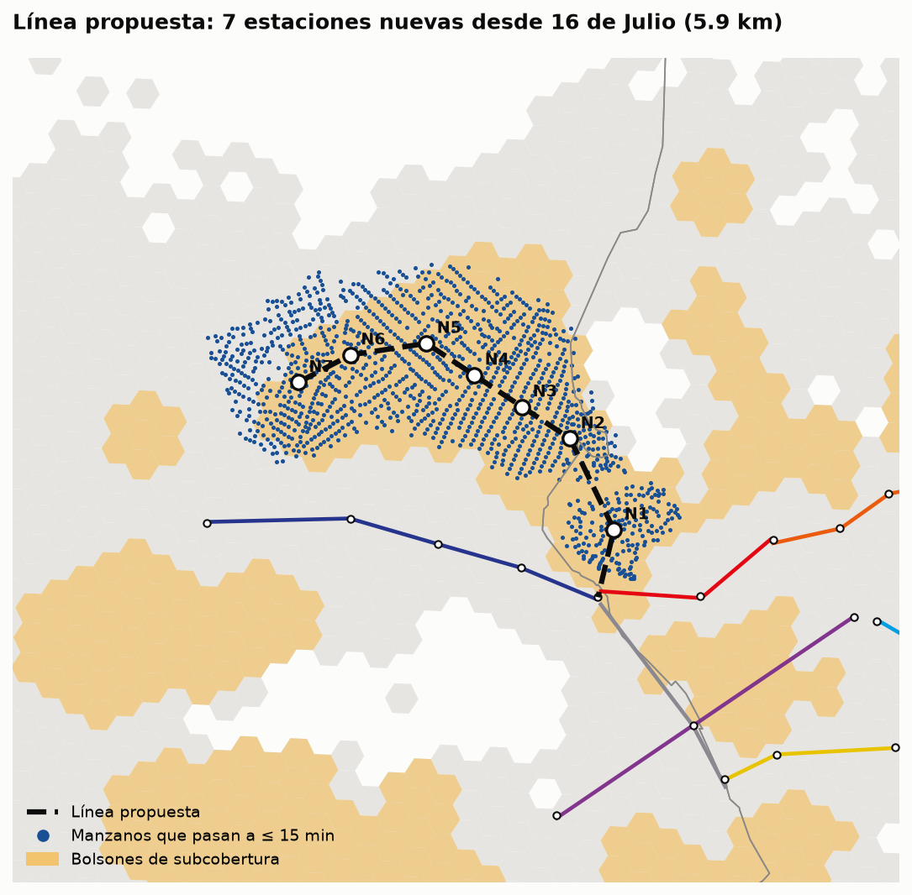
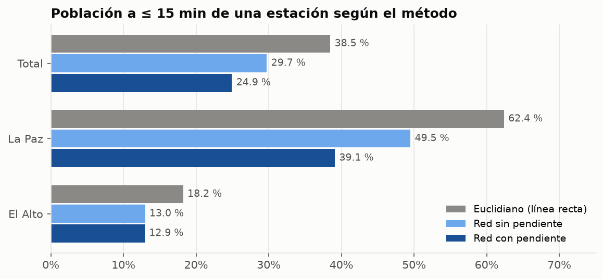

# 🚡 Mi Teleférico: ¿quién queda lejos del cable?

**Solo 1 de cada 4 habitantes de La Paz y El Alto vive a 15 minutos a pie de una estación de Mi Teleférico.
Una línea de 7 estaciones al norte de El Alto le daría acceso a 95 mil personas más.**

[](https://freddxvill.github.io/analisis-proyeccion-linea-teleferico-la-paz-bolivia/)
[](https://github.com/freddxvill/analisis-proyeccion-linea-teleferico-la-paz-bolivia/actions/workflows/publish.yml)


👉 **[Ver el sitio con mapas y gráficos interactivos](https://freddxvill.github.io/analisis-proyeccion-linea-teleferico-la-paz-bolivia/)** ·
[Notebooks](https://freddxvill.github.io/analisis-proyeccion-linea-teleferico-la-paz-bolivia/notebooks.html) ·
[Metodología](https://freddxvill.github.io/analisis-proyeccion-linea-teleferico-la-paz-bolivia/metodologia.html)



## El problema

En 2025 Mi Teleférico transportó **87,7 millones de pasajeros**. Es la columna vertebral del transporte masivo
de un área de **1,64 millones de habitantes** (Censo 2024): 10 líneas, unos 33 km de cable y 26 estaciones.

La red se planificó por corredores, no por cobertura. Y en una ciudad que va de 3.000 a 4.600 m de altura, la
distancia en un mapa no dice cuánto se tarda en llegar a pie: subir una ladera de La Paz cuesta mucho más
que cruzar el llano de El Alto. Antes de decidir dónde va la próxima línea hay que saber **quién queda lejos
del cable de verdad** y **dónde una línea nueva cubriría más gente por cada km de cable**.

## Hipótesis y solución

| Hipótesis | Cómo se probó | Resultado |
|---|---|---|
| **H1.** La distancia en línea recta sobreestima la cobertura; con caminata real y pendiente es mucho menor. | Grafo peatonal dirigido de OSM, pendiente del DEM Copernicus y velocidad de Tobler (subir ≠ bajar). Dijkstra multi-origen desde las estaciones. | ✅ Confirmada: 38,5 % → **24,9 %** |
| **H2.** Hay zonas densas sin cobertura, sobre todo en la periferia de El Alto. | DBSCAN ponderado por población sobre hexágonos H3 no cubiertos, con prueba de robustez. | ✅ Confirmada: **16 zonas sin cobertura** con 561 mil personas |
| **H3.** La población a pie de una estación explica su demanda y permite estimar pasajeros de una línea nueva. | Binomial negativa por estación (n = 26) con validación leave-one-out. | 🔄 Reformulada: manda ser **cabecera El Alto ↔ La Paz** (×6,7), no la población a pie |

Con eso, un modelo de **máxima cobertura (MCLP)** y la **p-mediana** eligen dónde poner estaciones nuevas, y una
búsqueda en haz arma el trazado de la línea que se conecta a la red actual.

## Resultados clave

- **75 % de la población (1,23 M de personas) vive a más de 15 min a pie de una estación.** La mediana es de 31 min.
- **La línea recta miente:** un buffer euclidiano da 38,5 % de cobertura; la red de calles real, 29,7 %; con
  pendiente, **24,9 %**. Son 221 mil personas que los análisis con buffers cuentan como cubiertas y no lo están.
- **El Alto es el gran vacío:** 12,9 % de cobertura frente al 39,1 % de La Paz, con el 54 % de la población.
- **Brecha de equidad:** 44 % de cobertura en el quintil menos vulnerable frente al 6 % en el más vulnerable.
- **La demanda la mueven las puertas entre ciudades:** las 7 cabeceras de las líneas Roja, Amarilla y Morada
  concentran el 71 % de los abordajes.
- **Propuesta:** línea de **7 estaciones y 5,9 km** desde 16 de Julio hacia el norte de El Alto.
  - **+95 mil personas** a ≤ 15 min (16,2 mil por km, por encima de las 13,2 mil por km de la red actual).
  - La cobertura de El Alto sube de **12,9 % a 21,6 %**; la total, de 24,9 % a 30,8 %.
  - El **63 %** de los nuevos cubiertos es población vulnerable.
  - Captaría **~9 M de abordajes al año** (IC 90 %: 5-14 M).
- **Contraste:** la extensión anunciada de la Línea Café a Pampahasi cae en una zona sin cobertura real (San Antonio) y cubre
  ~18 mil personas nuevas (14,8 mil por km).



## Cómo se hizo

```mermaid
flowchart LR
    P["🎯 Problema<br/>¿Quién queda lejos de una estación?<br/>¿Dónde va una nueva línea?"]

    subgraph D["📥 Datos"]
        D1["PDF Indicadores<br/>Mi Teleférico 2014-2025"]
        D3["GTFS comunitario<br/>líneas y estaciones"]
        D4["OpenStreetMap<br/>red peatonal"]
        D5["Censo 2024<br/>población por manzano"]
        D6["DEM Copernicus<br/>elevación"]
    end

    subgraph T["⚙️ Procesamiento"]
        T1["Extracción de tablas PDF"]
        T2["Grafo peatonal dirigido<br/>+ pendiente (Tobler)"]
        T3["Población → hexágonos H3"]
    end

    subgraph A["🔎 Análisis"]
        A1["EDA de demanda<br/>líneas · estaciones · meses"]
        A2["Isócronas 5/10/15/20 min<br/>cobertura: 24,9 % a ≤ 15 min"]
        A3["Lente de equidad<br/>brecha de accesibilidad"]
    end

    subgraph M["🧮 Modelado"]
        M0["Zonas sin cobertura<br/>DBSCAN: 16 zonas"]
        M1["Modelo de demanda<br/>por estación (binomial negativa)"]
        M2["Optimización MCLP / p-mediana<br/>nuevas estaciones"]
        M3["Trazado de línea<br/>+ sensibilidad k y umbral"]
    end

    R["📊 Resultados<br/>75 % a más de 15 min a pie<br/>línea de 7 estaciones: +95 mil personas<br/>~9 M abordajes/año"]

    subgraph E["🚀 Entregables"]
        E1["Sitio Quarto · GitHub Pages<br/>ECharts + MapLibre"]
        E2["Notebooks renderizados"]
        E3["README BLUF"]
    end

    P --> D
    D1 --> T1
    D3 & D4 & D6 --> T2
    D5 --> T3
    T1 --> A1
    T2 & T3 --> A2
    A2 --> A3
    A1 & A2 --> M1
    A2 & A3 --> M0
    M0 --> M2
    M2 --> M3
    M1 --> M3
    M3 --> R
    R --> E1 & E2 & E3

    classDef problema fill:#f0efec,stroke:#52514e,color:#0b0b0b
    classDef datos fill:#cde2fb,stroke:#256abf,color:#0b0b0b
    classDef proc fill:#d9f2e8,stroke:#199e70,color:#0b0b0b
    classDef analisis fill:#fde3d7,stroke:#d95926,color:#0b0b0b
    classDef modelo fill:#e8e4fb,stroke:#6250d6,color:#0b0b0b
    classDef resultado fill:#ffeec2,stroke:#c98500,color:#0b0b0b
    classDef entrega fill:#f0efec,stroke:#52514e,color:#0b0b0b
    class P problema
    class D1,D3,D4,D5,D6 datos
    class T1,T2,T3 proc
    class A1,A2,A3 analisis
    class M0,M1,M2,M3 modelo
    class R resultado
    class E1,E2,E3 entrega
    style D fill:#fcfcfb,stroke:#c3c2b7
    style T fill:#fcfcfb,stroke:#c3c2b7
    style A fill:#fcfcfb,stroke:#c3c2b7
    style M fill:#fcfcfb,stroke:#c3c2b7
    style E fill:#fcfcfb,stroke:#c3c2b7
```



La fuente del diagrama es [`docs/diagrama.mmd`](docs/diagrama.mmd); también está como imagen en
[`site/assets/img/diagrama.svg`](site/assets/img/diagrama.svg).

## Datos

| Fuente | Qué aporta | Licencia |
|---|---|---|
| [Mi Teleférico, Indicadores de Gestión 2014-2025](https://www.miteleferico.bo/) (PDF, 109 págs.) | Pasajeros por año, mes, línea y estación | Datos públicos |
| [GTFS comunitario de Mi Teleférico](https://datosbolivia.github.io/gtfs/) | Líneas y estaciones con coordenadas | CC-BY-4.0 |
| [OpenStreetMap](https://www.openstreetmap.org/) vía OSMnx | Red peatonal, límites municipales y macrodistritos | ODbL |
| [Censo 2024 por manzano](https://github.com/lab-tecnosocial/censosbo) (INE, repackaging de lab-tecnosocial) | Población y 194 indicadores socioeconómicos | Datos públicos del INE |
| [Copernicus DEM GLO-30](https://registry.opendata.aws/copernicus-dem/) | Elevación para la pendiente | Licencia Copernicus |

El PDF no trae tablas sino gráficos con etiquetas: las series se reconstruyen por la posición y el color de cada
etiqueta, y se validan contra los totales impresos con tolerancia cero.

## Estructura

```
├── src/teleferico/
│   ├── ingest/           # mt_pdf, gtfs, censo, osm, dem, limites: descarga y limpieza
│   ├── access.py         # Tobler, grafo dirigido, Dijkstra multi-origen, isócronas
│   ├── equidad.py        # índice de vulnerabilidad y brecha de accesibilidad
│   ├── demand_model.py   # binomial negativa por estación con validación LOO
│   ├── optimize.py       # DBSCAN, MCLP, p-mediana y trazado de línea
│   ├── export_web.py     # JSON y GeoJSON para el sitio
│   └── pipeline.py
├── notebooks/            # 01 EDA · 02 red y pendiente · 03 cobertura · 04 demanda · 05 optimización
├── data/processed/       # salidas livianas versionadas (data/raw queda fuera de git)
├── reports/figures/      # figuras estáticas de los notebooks
├── site/                 # sitio Quarto: ECharts 5 + MapLibre 4 sobre OpenFreeMap
└── docs/                 # diagrama.mmd y glosario.md
```

¿Términos desconocidos (MCLP, DBSCAN, isócrona, línea recta…)? Ver el [glosario](docs/glosario.md).

> **Nota sobre nombres:** en el código y en los datos, las **zonas sin cobertura** se llaman `bolson` o
> `bolsones` (la columna `bolson`, la función `resumen_bolsones`, los archivos `bolsones.parquet` y
> `bolsones.geojson`). Las etiquetas Z1, Z2… del notebook 05 siguen el orden de `bolsones.parquet`, de mayor a
> menor población no cubierta.

## Decisiones de modelado

- **Tobler direccional:** `v = 6·exp(−3,5·|s + 0,05|)` km/h, con la pendiente medida cada 30 m sobre el DEM
  suavizado. Subir es 1,42 veces más lento que bajar la misma pendiente.
- **Hexágonos H3 de resolución 9** (≈ 0,1 km²) como unidad de demanda y para el mapa web; el tiempo se
  calcula por manzano y luego se agrega.
- **Umbral de 15 min**, con sensibilidad a 10 min y a la variante sin pendiente.
- **El modelo de demanda** se eligió por error LOO (1,13 M frente a 3,13 M del modelo nulo) y se reporta con
  intervalos, porque n = 26 es chico.
- **Línea de teleférico:** tramos rectos entre estaciones, que parten de una estación existente para permitir el transbordo.

## Limitaciones

- Solo se mide el acceso **a pie**. El minibús, principal alimentador del teleférico, queda fuera, así que la
  cobertura efectiva es mayor que la reportada.
- Copernicus GLO-30 es un modelo de superficie (incluye techos), no de terreno. Se suaviza y se prueba la
  sensibilidad: la cobertura queda entre 20 % y 26 %.
- La propuesta es un **escenario guiado por datos**, no un diseño de ingeniería: no considera derechos de vía,
  torres ni costos. El corredor es robusto; la ubicación exacta de cada estación, no.
- El ranking por estación del PDF viene en porcentajes con un decimal, así que los absolutos son estimaciones.

## Cómo reproducir

Requiere [uv](https://docs.astral.sh/uv/) y, para el sitio, [Quarto](https://quarto.org/) 1.7.

```bash
uv sync                                    # entorno con Python 3.13
uv run python -m teleferico.pipeline       # descarga las fuentes y regenera data/processed/
uv run pytest                              # validaciones de los datos procesados

cd site
quarto run scripts/preparar.ts             # copia notebooks y diagrama al sitio
quarto preview                             # o: quarto render
```

Se puede correr un solo paso con `--pasos`, por ejemplo `--pasos acceso optimizacion`. La optimización es el
paso más lento (~17 min). El sitio no ejecuta Python: lee los JSON de `site/data/` y muestra los notebooks con
sus resultados guardados. Cada push a `main` lo publica en GitHub Pages.

---

## English summary

**Who lives far from the cable?** Only **24.9 %** of the 1.64 M people in La Paz and El Alto (Bolivia) live
within a 15-minute walk of a Mi Teleférico cable car station, once real streets and slope (directional Tobler
hiking function on a Copernicus DEM) are accounted for. A straight-line buffer says 38.5 %. El Alto is the main
gap (12.9 %), and the most vulnerable quintile has 6 % coverage against 44 % in the least vulnerable one.
DBSCAN finds 16 dense, uncovered pockets, and an MCLP / p-median optimization proposes a **7-station, 5.9 km
line** north of El Alto that reaches **95 k new residents** (63 % vulnerable) and would carry about **9 M
boardings a year** (90 % CI: 5-14 M), estimated with a negative binomial model of station demand.
[Live site](https://freddxvill.github.io/analisis-proyeccion-linea-teleferico-la-paz-bolivia/) (in Spanish).
